# Our World

ThreeJS conversion of [a video about the solar system](https://www.tiktok.com/@sopaguada/video/7690600273236004103) by @sopaguada.

**Live:** [mpts.ie/games/ourworld](https://mpts.ie/games/ourworld/)

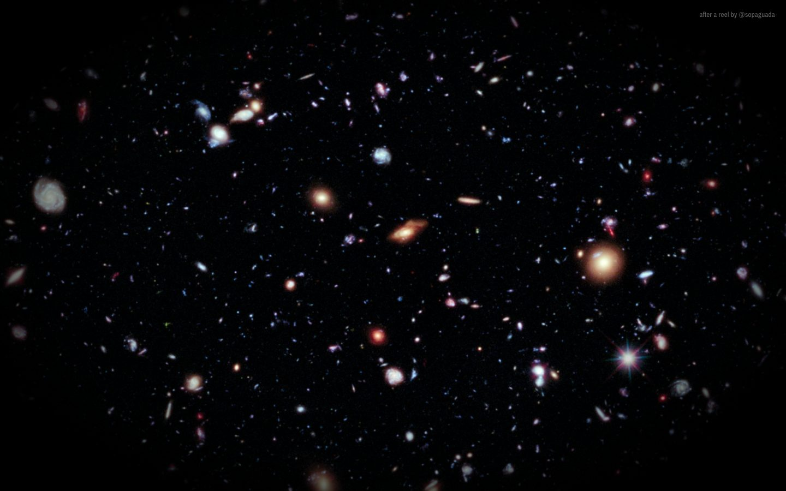

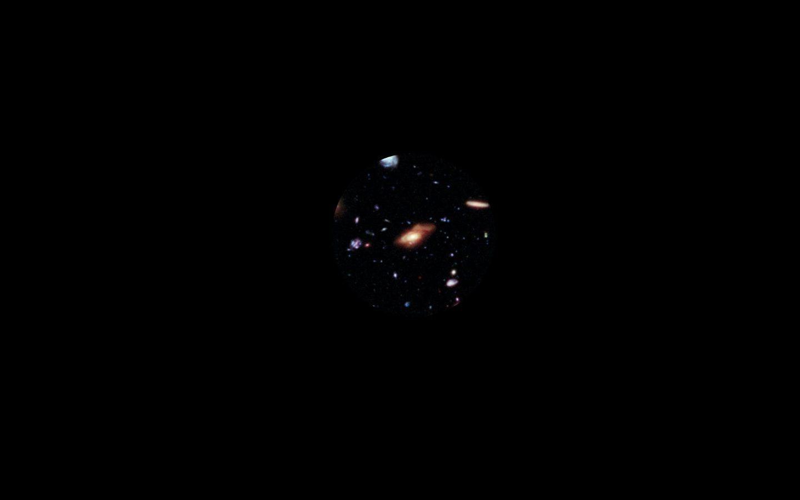

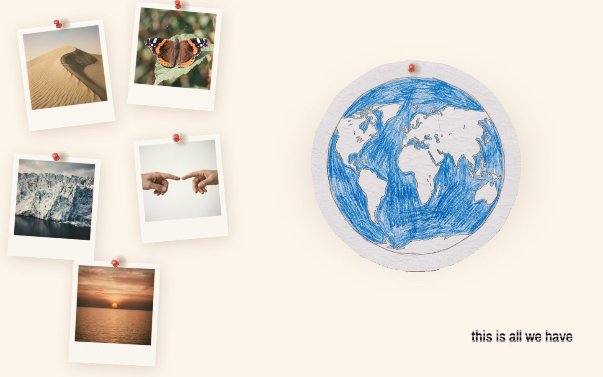

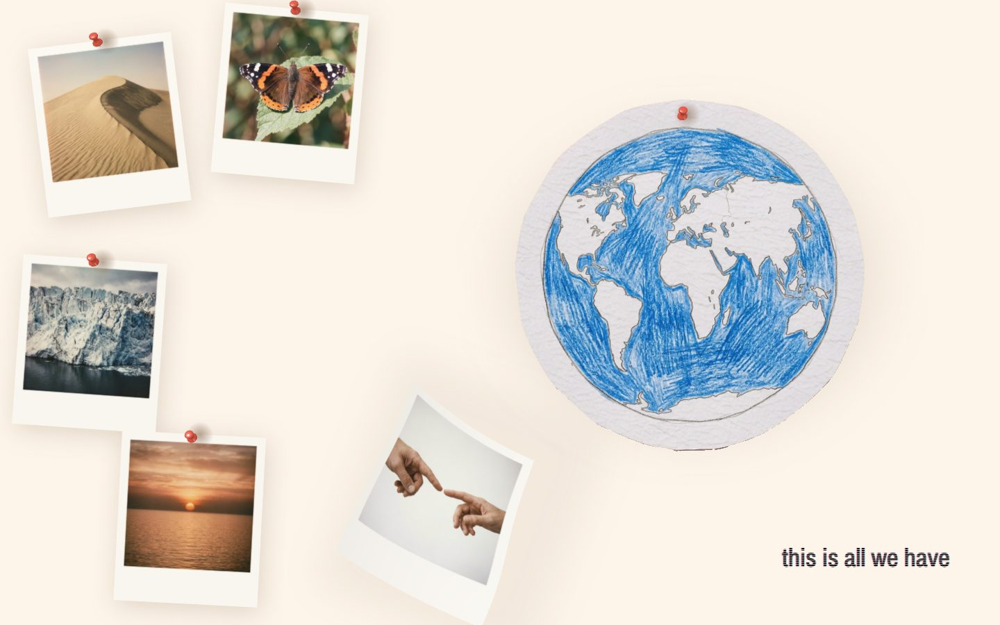

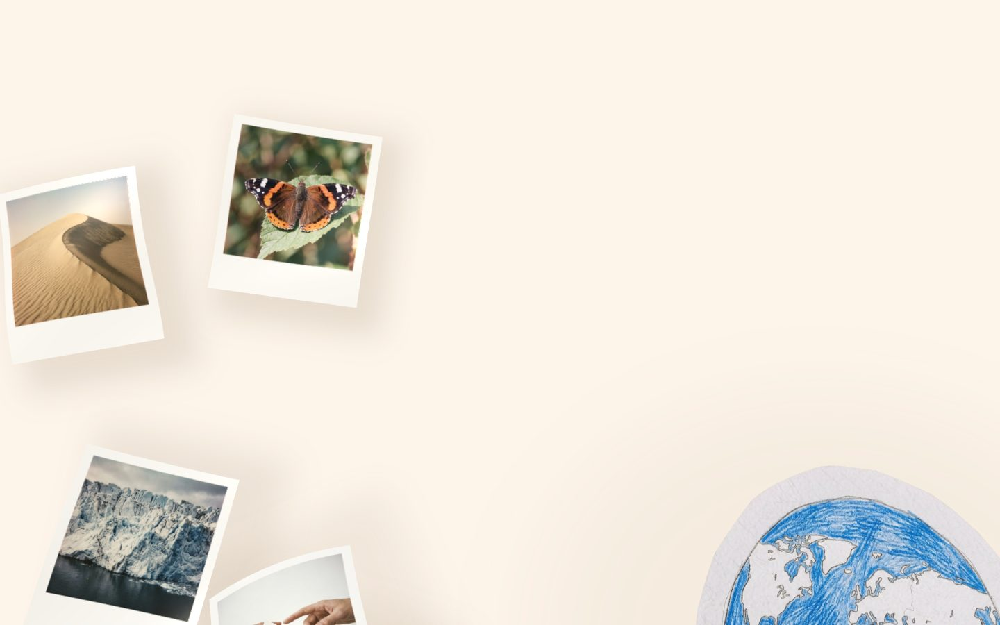

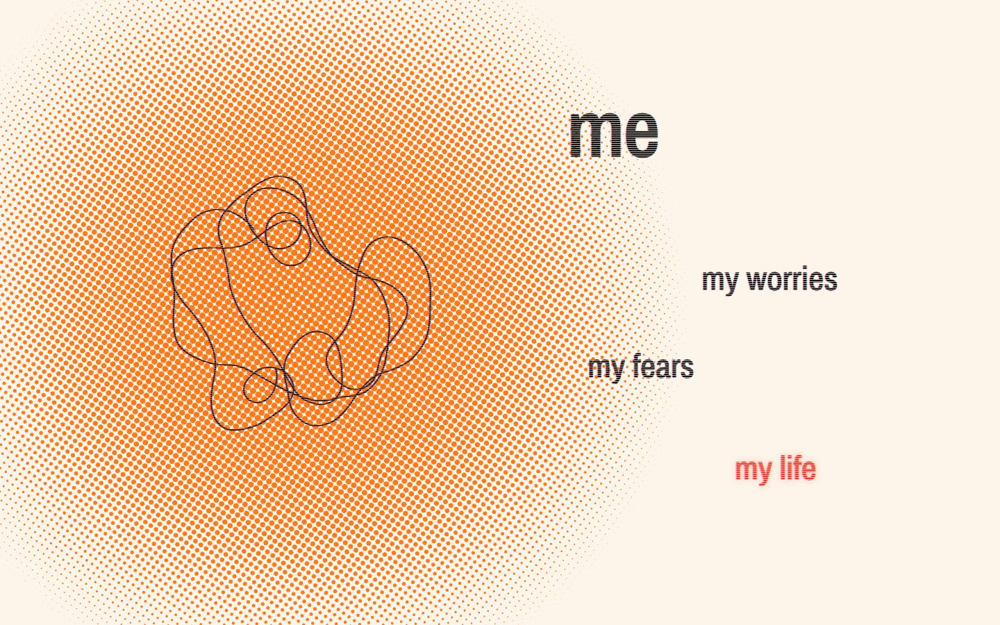

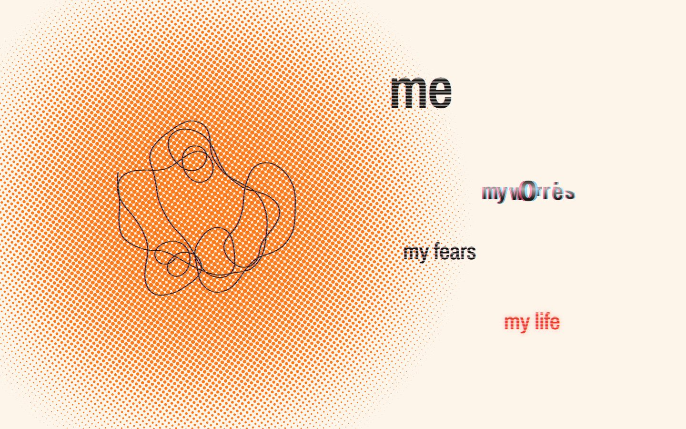

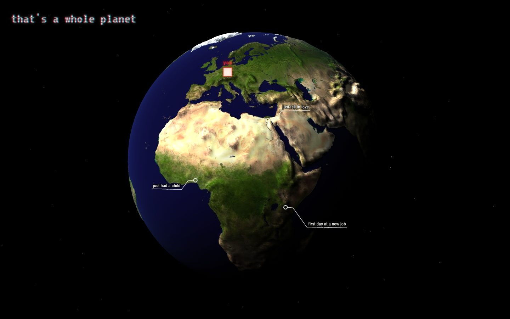

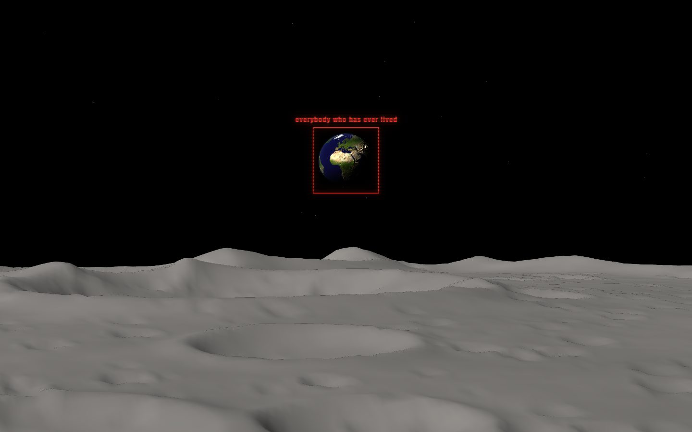

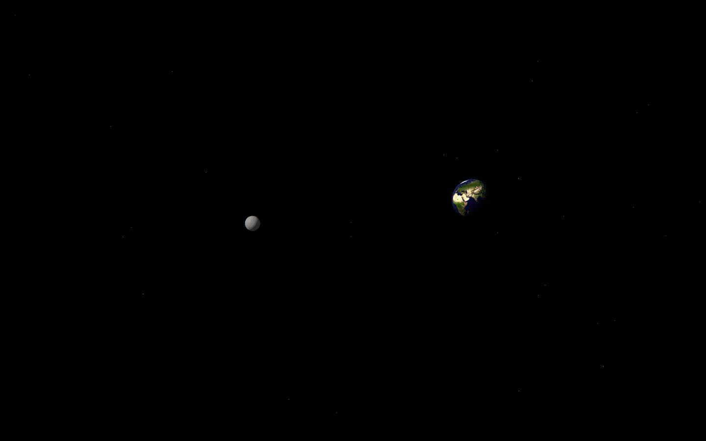

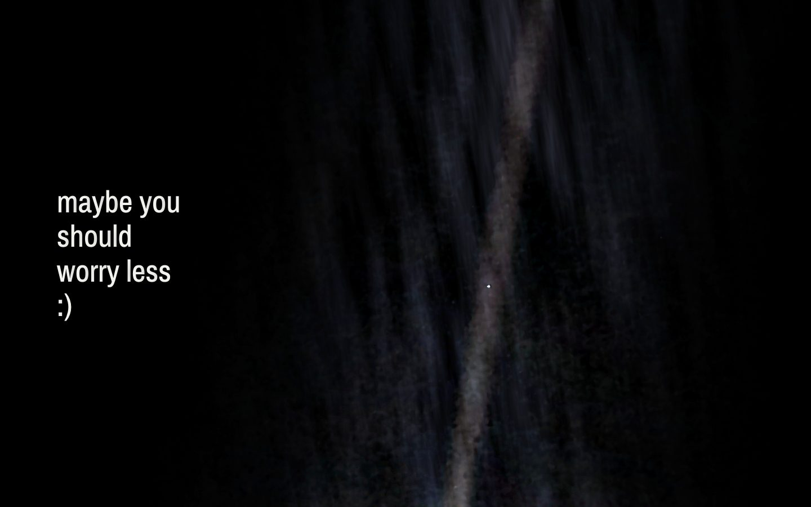

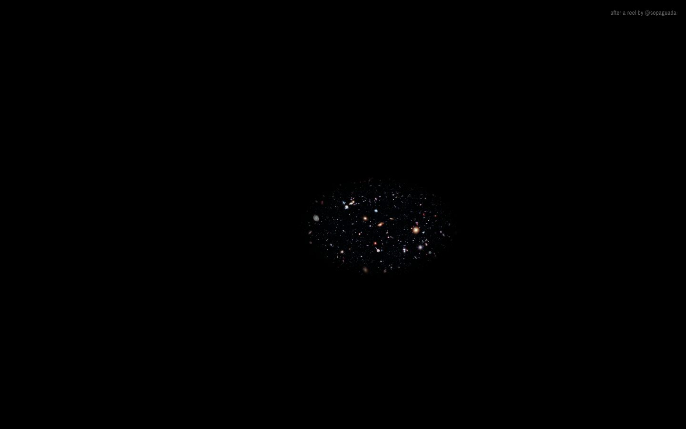

## Credits

- **Original reel:** [@sopaguada](https://www.tiktok.com/@sopaguada/video/7690600273236004103) on TikTok.
- **Hubble eXtreme Deep Field (2012):** NASA, ESA, G. Illingworth, D. Magee, P. Oesch (UC Santa Cruz), R. Bouwens (Leiden) and the HUDF09 team.
- **Pale Blue Dot Revisited (PIA23645, 2020):** NASA/JPL-Caltech, from Voyager 1's 1990 image. The pillar of light around the dot is a reworking of that image.
- **Earth texture and elevation:** NASA Blue Marble and NASA elevation data.
- **The polaroid photographs and the paper earth** were generated for this project.
- Built with [three.js](https://threejs.org/), Archivo Narrow and VT323 from Google Fonts.

## License

The code is [MIT](LICENSE). The NASA and ESA imagery keeps the terms credited above.

## Development

Static site in [`public/games/ourworld/`](public/games/ourworld/), served at `mpts.ie/games/ourworld` by a Cloudflare Worker.

```bash
npm install
npm run dev      # local preview
npm run deploy   # deploy the worker and its assets
```
